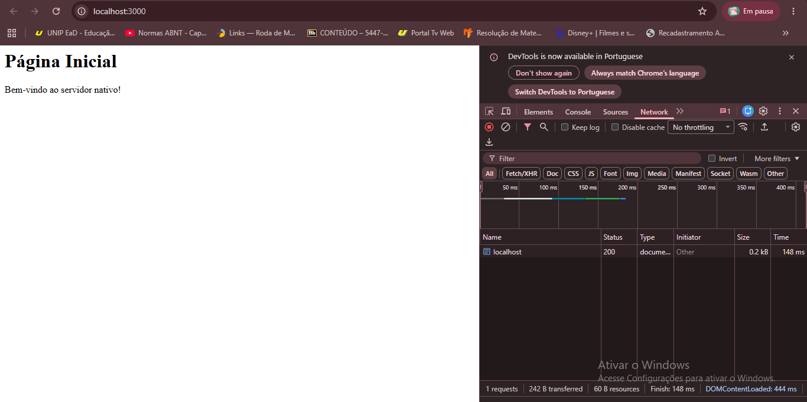
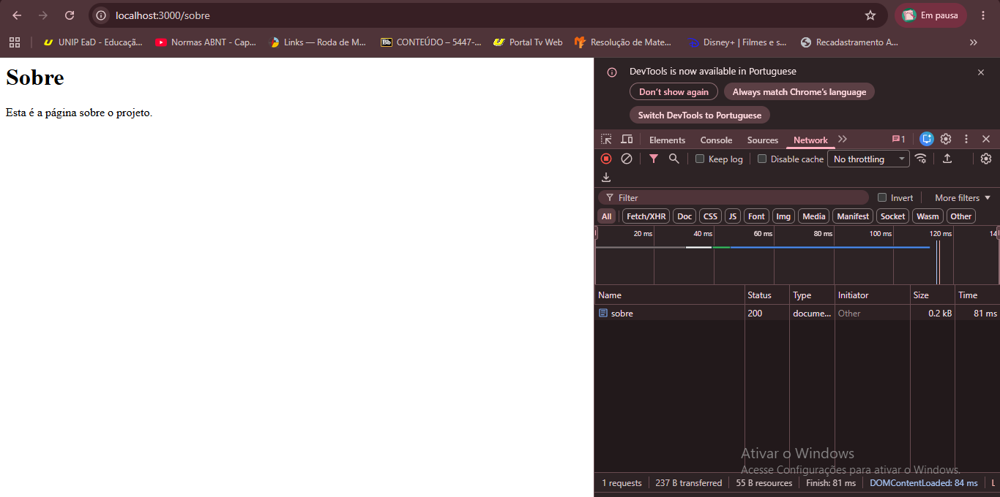
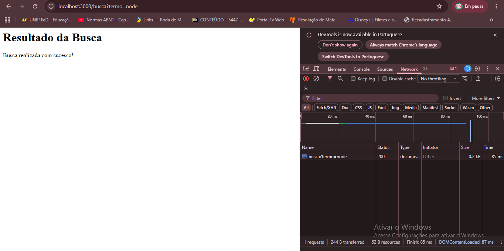
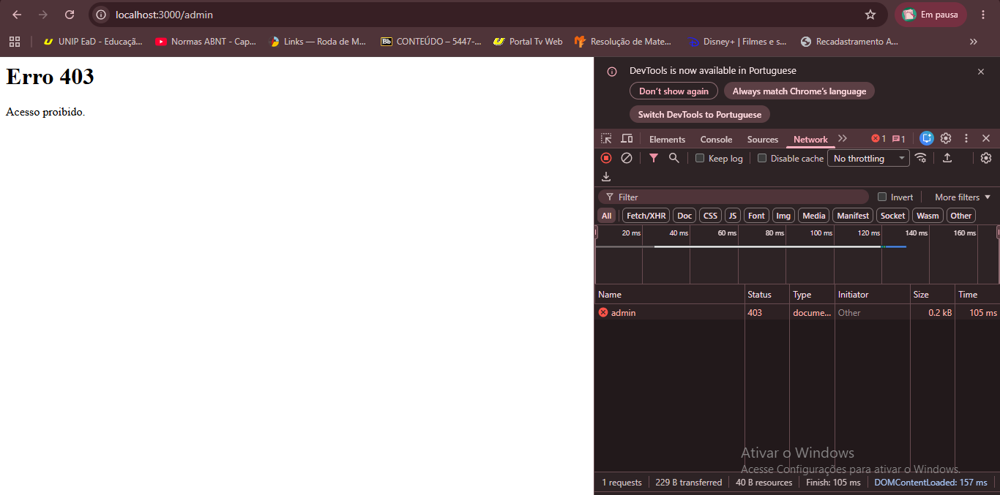

# Protocolo HTTP: Requisição, Resposta, Métodos, Status e Cabeçalhos

Nome: Sofia Sousa Rocha 
Curso: Sistemas para Internet 

# Cliente e Servidor -
Quando digitamos uma URL (como "http://localhost:3000/") no navegador:

DNS: O navegador busca o endereço IP real do servidor associado ao nome de domínio que você digitou.
Conexão: É estabelecida uma conexão de rede segura (TCP) entre o navegador e o servidor.
Requisição: O navegador envia um pedido formal ao servidor dizendo o que deseja
Resposta: O servidor processa o pedido e envia os arquivos do site (como o HTML da página) O navegador lê esses arquivos e desenha a página na sua tela.

# Anatomia da Requisição e da Resposta

Requisição: Possui a linha inicial (método, caminho e versão do HTTP), os cabeçalhos (metadados como o navegador usado) e o corpo (dados enviados, comum em cadastros).

Resposta: Possui a linha de status (versão do HTTP e código de sucesso/erro), os cabeçalhos (tipo de arquivo, tamanho) e o corpo (o conteúdo visual, como HTML).

# Métodos HTTP
GET: Solicita a leitura ou busca de um recurso. Não altera dados no servidor, pois serve apenas para buscar dados.
POST: Envia novos dados ao servidor para serem criados ou processados novos recursos.
PUT: Substitui um recurso existente ou cria caso não exista, pelos novos dados enviados.
PATCH: Modifica apenas partes específicas de um recurso já existente.
DELETE: Remove um recurso específico do servidor.

Método Seguro: Não altera o estado do servidor (ex: GET). É uma operação apenas de leitura que não causa efeitos colaterais.
Método Idempotente: Se for executado uma vez ou múltiplas vezes seguidas produz exatamente o mesmo resultado final no servidor. (ex: GET, PUT, DELETE). O POST não é idempotente, pois cada clique pode gerar um registro duplicado.

# Códigos de Status (Famílias)
1xx (Informativo): A requisição foi recebida e o processo continua.
2xx (Sucesso): A ação foi recebida, compreendida e aceita com sucesso.
3xx (Redirecionamento): O cliente precisa tomar uma ação adicional para completar o pedido.
4xx (Erro do Cliente): A requisição possui sintaxe errada ou não pode ser processada por culpa do cliente.
5xx (Erro do Servidor): O servidor falhou ao tentar processar uma requisição válida.

# Diferenças:
401: Significa que o usuário não está autenticado, é necessário fazer login para acessar pois o servidor não sabe quem ele é.
403: O servidor sabe quem ele é, mas ele não tem permissão para acessar aquela página específica.
301: É definitivo, muda o endereço permanentemente nos buscadores.
302: É apenas temporário, o site está em manutenção ou passando por uma condição momentânea.

# Cabeçalhos de Resposta e Requisição
Content-Type: Diz ao navegador qual é o formato do arquivo que está chegando.
Content-Length: Informa o tamanho do corpo da resposta em bytes.
Location: Usado em redirecionamentos para dizer para qual nova URL o navegador deve ir.
Allow: Informa quais métodos HTTP são permitidos em uma determinada rota.
Cache-Control: Define regras de como e por quanto tempo o navegador pode guardar a página na memória cache.
User-Agent: Enviado pelo cliente para se identificar perfeitamente ao servidor, detalhando qual navegador, sistema operacional e versão estão sendo usados.
Accept: Cabeçalho de requisição que avisa ao servidor quais formatos de resposta o cliente consegue entender.

# HTTP é Stateless
Cada requisição é tratada de forma totalmente isolada. O servidor esquece quem é o cliente assim que envia a resposta. Ele não se lembra da requisição anterior a menos que sejam usadas ferramentas externas como Cookies ou Tokens.

# HTTP x HTTPS
O HTTP envia as informações em texto limpo pela rede. Se alguém interceptar os dados, conseguirá ler tudo. O HTTPS adiciona uma camada de criptografia (SSL/TLS). Mesmo interceptados, os dados viram códigos ilegíveis, garantindo segurança.

# 2. Evidências

Incial `/`
*  
O print mostra o navegador carregando a estrutura HTML inicial com o status 200 OK obtido com sucesso.

Rota `/sobre`
* 
O print demonstra o carregamento da página de informações com status 200 OK.

Rota `/busca` (com parâmetro)

O print exibe o status 200 OK processando dinamicamente o termo enviado na URL.

Rota `/admin`

O print exibe o bloqueio de segurança com o código correspondente de acesso proibido (403 Forbidden).

### Respostas do comando `curl -i` no Terminal

## 3. Conclusão

Após realizar esta pesquisa e aplicar os conceitos na prática, percebi que os servidores que vínhamos construindo em sala de aula de forma automática omitiam detalhes fundamentais sobre a comunicação na web. Eu mudaria a forma como tratamos as respostas: antes costumávamos responder quase tudo com o padrão genérico do navegador ou apenas com textos puros. Agora entendo a importância de explicitar o código de status correto (como usar um 400 ou 405 em vez de deixar a requisição travar ou retornar um erro genérico) e a obrigatoriedade de injetar cabeçalhos cruciais como o `Content-Type` com `charset=utf-8` para evitar problemas de acentuação e garantir que o cliente interprete a resposta exatamente como planejado.

## 5. Declaração de Uso de IA

OPENAI. ChatGPT (Modelo GPT-4o). Ferramenta de inteligência artificial generativa. Data de uso: 15 out. 2026.  
* **Finalidade:** Dúvida conceitual sobre herança de métodos, estruturação de rotas nativas usando `url.parse` sem frameworks e formatação da resposta HTTP no terminal.  
* **Arquivos impactados:** `src/routes/index.js` e `src/server.js`.
